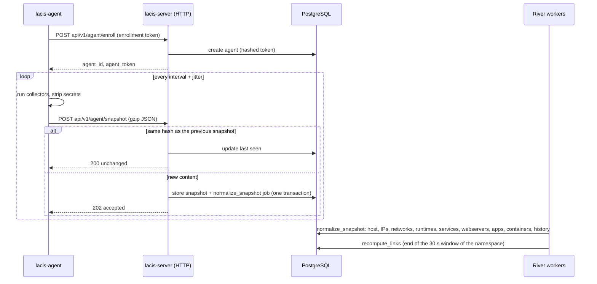

# Architecture

## Modules

The repository holds three Go modules and the front:

| Module / folder | Import path | Content |
| --------------- | ----------- | ------- |
| `/` | `github.com/alexandreh2ag/lacis` | `lacis-server` |
| `agent/` | `github.com/alexandreh2ag/lacis/agent` | `lacis-agent` |
| `common/` | `github.com/alexandreh2ag/lacis/common` | the contract shared by both: snapshot format, labels, DSN parsing, agent API, version |
| `web/` | - | React front (Vite, Apollo, React Flow, ELK), built into `web/dist` and embedded in `lacis-server` |

The agent and the server never import each other; `replace` directives point
`common` to the local folder during development.

## Data flow

- **Enrollment** creates an agent (an identity and a revocable token). The host
  comes with the first snapshot.
- **Ingestion** validates the snapshot (schema version, labels, body sizes, texts of
  8 KiB and lists of 10,000 items at most), refuses an agent sending sooner than
  `agent_api.min_interval`, checks that
  its namespace is the one of its host, and compares its hash with the previous
  snapshot's. The hash ignores the values that change at every collection
  (collection date and durations, uptime).
- **Normalization** only processes the latest snapshot of a host: an older one
  queued behind a newer one is skipped. It synchronizes the tables of the host,
  marks the entities that disappeared as removed, and writes the changes to the
  history. The Docker containers are kept too, but make no change event. It then enqueues the recomputation of the links of the namespace.
- **Link computation** is a pure function of the namespace inventory, see
  [Linking](./linking.md). It replaces the links of the namespace and writes the
  links added and removed to the history.

## Server packages

| Package | Role |
| ------- | ---- |
| `cli/` | cobra commands |
| `config/` | configuration loading and validation |
| `http/` | echo server; routes `agent`, `auth` (local and OIDC), `graphql`, `icon`, `health`, `ui` |
| `graph/` | gqlgen GraphQL schema (`graph/schema/*.graphqls`), resolvers, `@can`/`@canGlobal` directives |
| `auth/` | principal and permission checks; `auth/openid` for the OIDC code flow |
| `service/` | business logic: ingestion, normalization, linking, metadata, users, roles, tokens, tasks |
| `repository/` | GORM data access, transactions |
| `model/` | database models |
| `database/` | connection, migrations (`migrations/*.sql`, embedded) |
| `queue/` | River client, jobs and scheduled tasks |
| `linker/` | link resolution |
| `domainmatch/` | matching of names against webserver domain patterns, shared by the linker and the impact analysis |
| `topology/` | graph building (views, stacks, impact) and rendering (Mermaid, DOT, JSON) |
| `history/` | change events of the normalization and of the links |
| `icon/` | validation of the uploaded logos |

## Agent packages

| Package | Role |
| ------- | ---- |
| `agent/cli/` | cobra commands |
| `agent/config/` | configuration |
| `agent/collector/` | collectors: `host`, `runtimes`, `services`, `docker`, `webservers`, `apps`, `envfiles` |
| `agent/system/` | shared reads of the system: processes, listeners, packages, supervisor programs; reads and probes as another user |
| `agent/exec/` | the only place running commands, as the agent or as another user |
| `agent/fsutil/` | safe reads of files: regular files only, size-capped, no blocking |
| `agent/service/` | collection, enrollment, run loop |
| `agent/client/` | HTTPS client of the agent API |
| `agent/state/` | identity file |

The collectors register themselves; each declares the collectors it depends on and
runs once they are done, the others concurrently. Each works on its own copy of the
snapshot, merged back when it ends in time, so that a collector abandoned after its
timeout never touches the snapshot sent.

## Background jobs

Jobs run on [River](https://riverqueue.com/), in the Lacis database, in the `start`
process (`workers.enabled`) or in separate `worker` processes.

| Job | Enqueued by | Does |
| --- | ----------- | ---- |
| `normalize_snapshot` | each accepted snapshot | normalizes it into the tables of its host |
| `recompute_links` | normalization, metadata changes | computes the links of a namespace; unique per namespace and 30-second window |
| `purge_snapshots`, `purge_removed_entities`, `purge_expired_tokens`, `detect_token_conflicts`, `purge_history`, `purge_inactive_hosts`, `purge_unused_projects`, `purge_unused_environments` | `workers.schedules`, or a run by hand in the administration | [scheduled tasks](./configuration/server.md#workers) |

A scheduled task runs once across the processes, for 15 minutes at most, and is
tried 5 times with a growing backoff. The administration lists the tasks, their
last runs with what they changed, and the failed jobs; it runs a task now or a
failed job again (`tasks` permission).

## Storage

PostgreSQL holds everything; the server keeps no local state.

| Area | Tables |
| ---- | ------ |
| organisation | `namespaces`, `projects`, `environments`, `networks`, `network_cidrs`, `host_networks` |
| agents | `enrollment_tokens`, `agents`, `snapshots` (raw JSON) |
| inventory | `hosts`, `host_ips`, `runtimes`, `services`, `webservers`, `apps`, `app_dependencies`, `endpoints`, `containers` |
| graph | `links`, `change_events` |
| access | `users`, `sessions`, `roles`, `user_roles`, `role_oidc_groups`, `namespace_permissions`, `global_permissions`, `oauth_clients`, `oauth_codes`, `oauth_grants` |
| other | `tech_icons`, and River's own tables |

Tokens (enrollment, agent, session) are stored hashed; passwords are hashed.
