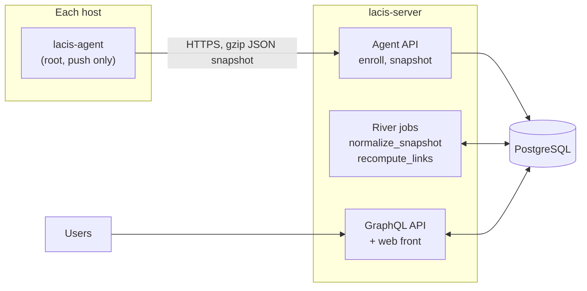

# Lacis

Lacis maps a server infrastructure: hosts, services, runtimes, deployed
applications and the links between them. An agent on each host pushes a
snapshot; the server stores it, resolves the dependencies between apps and
services, and serves a navigable graph.

Lacis is an **inventory**, not a monitoring tool: it records what runs where and
what talks to what, with sizes (memory, disk size) but never usage or instant
values.

:::note[Status]
Lacis is in early development. The configuration keys, the snapshot format and the
API may still change between versions.
:::

## Components

| Component      | Path in the repository | Role                                                        |
| -------------- | ---------------------- | ----------------------------------------------------------- |
| `lacis-server` | `/`                    | agent API (REST), front API (GraphQL), storage, link engine |
| `lacis-agent`  | `agent/`               | local collection, secret filtering, HTTPS push              |
| `common`       | `common/`              | contract shared by both: snapshot, labels, DSN, agent API   |
| front          | `web/`                 | React single-page app embedded in `lacis-server`            |

The agent and the server never import each other: they only share the
`common` module, which defines the snapshot format and the agent API.

## How it works

1. **Collect.** On each host, `lacis-agent` runs its [collectors](./collectors.md)
   every `interval` (plus a random jitter): host description, runtimes, services,
   Docker containers, webservers and their routing, deployed apps and the
   dependencies read from their configuration. Credentials are stripped on the
   host, before anything is sent.
2. **Push.** The agent sends the snapshot, a single gzip-compressed JSON document,
   to the server over HTTPS. The agent only pushes: the server never connects to
   the hosts. A snapshot identical to the previous one only updates the
   "last seen" date of the host.
3. **Normalize.** A background job turns the stored snapshot into the tables of
   the host: runtimes, services, webservers, apps, containers, IPs and networks. The
   namespace, project and env named by the labels of the host are created on
   first sight. Every change is written to the history of the namespace.
4. **Link.** The links of the namespace are computed again at the end of a
   30-second window: each app dependency and each webserver route is resolved to
   an app, a service, a webserver, a host or an external target. See
   [Linking](./linking.md).
5. **Graph.** The front reads the inventory and the graph through the GraphQL
   API, with access limited by [roles and permissions](./permissions.md).

## Organisation

- A **namespace** groups the hosts of one organisation or customer (for example
  `acme`). Every agent declares its namespace with the `namespace` label.
- A **project** (`shop`, `crm`…) and an **env** (`production`, `staging`…) come
  from the `project` and `env` labels of the host. An app can override them in its
  version file (`.app.lacis.json`). A host then belongs to its labels' project and
  env **and** to those of every app it runs: it hosts several projects. So do its
  services and webservers, for the apps of their host that use them or that they
  serve (nginx, php-fpm behind it).
- A **network** groups the IPs of a namespace by CIDR; public IPs share one
  `public` network.

## Next steps

- [Install](./installation.md) the server and the agents.
- Read the [server](./configuration/server.md) and
  [agent](./configuration/agent.md) configuration references.
- Learn what the agent [collects](./collectors.md), and what it never sends.
